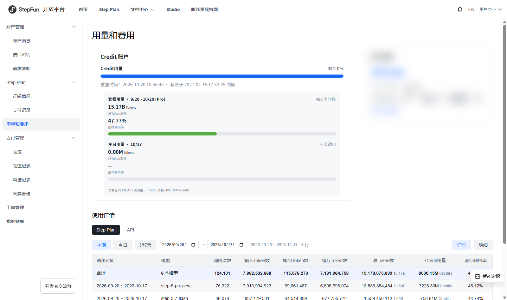

# StepFun 用量和费用增强（油猴脚本）

把阶跃星辰开放平台「用量和费用」页（`platform.stepfun.com/account-overview`）改成更好用的样子：**用量按当前计费周期看、列固定且有合计、Credit 和 Token 分开显示、日期随便选**。



非官方脚本：只读当前登录账号自己的页面接口，**不修改任何服务端数据**，也不上传任何东西。接口是逆向自己的用量页得来的，站点改版可能失效。

## 功能

**顶部**
- 「Credit 账户」与「账户金额」并排，和官方新版式的参考设计一致。
- Credit 账户卡内新增汇总块：`套餐用量（重置时间往前一个自然月）` 与 `今日用量`，各显示总 Token 消耗 + 缓存利用率进度条；底部一行 `套餐区间 N 次调用 · Credit 消耗 X Credits`。
- 在原生灰字行后补上「套餐于 YYYY-MM-DD HH:mm:ss 到期」。

**使用详情（脚本自己渲染，替换原表）**
- 固定 9 列：`调用时间 / 模型 / 调用次数 / 输入Token数 / 输出Token数 / 缓存Token数 / 总Token数 / Credit用量 / 缓存利用率`。
- 数字列右给小字单位：总 Token 显示 `15,170,073,699 15.17B`（M/B 自动），Credit 显示 `8000.15M Credits`。
- **首行固定「合计」行**（蓝底），永远跟着当前区间。
- 区间：`本期`（当前计费周期）/ `今日` / `近7天`，或**自己选开始/结束日期**（原生日期框，选定即按该区间重取）。
- 视图：`汇总`（按模型聚合）/ `明细`（按小时倒序，874 行也不卡）。
- 切到页面的 `API` 标签时，恢复站点原生表和原生日期控件（API 用量没有对应接口数据，不做假数据）。

## 安装

1. 浏览器装 [Tampermonkey](https://www.tampermonkey.net/)（或 Violentmonkey）。
2. 点这里安装脚本：[stepfun-usage-plus.user.js](https://raw.githubusercontent.com/yuloop/stepfun-usage-plus/main/stepfun-usage-plus.user.js)
   （Tampermonkey 会弹安装页，点「安装」）。
3. 打开 `https://platform.stepfun.com/account-overview`，刷新一次即可看到效果。

脚本自带 `@updateURL`，之后脚本更新会在 Tampermonkey 里提示。

## 口径（重要）

| 项 | 定义 |
| --- | --- |
| 计费周期 | 页面上的「重置时间」往前一个自然月 → 该重置时刻 |
| 总Token数 | 输入 + 输出 + 缓存读 |
| 缓存利用率 | 缓存 ÷ (输入 + 缓存) |
| Credit 消耗 | 接口返回的 `credit_consumed` 累加（Credit 是计费单位，不是 Token） |

> 站点的「输入Token数」看起来**已经包含**缓存读（实测 874 行里缓存从未超过输入，最大 175191/175183 ≈ 99.99%），所以上面的「总 Token 含缓存读」口径会把缓存算两遍、命中率偏低（约 47% 而不是 91%）。
> 脚本顶部留了一个开关，想用站点口径就改成 `false`：
>
> ```js
> var INCL_CACHE = true;  // false = 总Token 输入+输出；缓存利用率 = 缓存÷输入
> ```

## 更新日志

| 版本 | 变更 |
| --- | --- |
| 1.4.2 | 使用详情支持自己选日期（原生日期框）；修渲染签名漏 `end`、连续改两次日期被"请求中"吞掉 |
| 1.5.0 | 进页面不再先闪一下官方界面：`document-start` 注入 + 路由一变就用 CSS 预先遮住原生块，脚本渲染完再放开；首屏观察去抖 800→200ms，取数期间显示占位行 |
| 1.4.3 | 站内跳转（SPA 路由）也能生效，不再需要刷新；请求 15s 超时 + `busy` 20s 看门狗 + 本页兜底轮询 |
| 1.4.1 | 明细时段按毫秒解析（原来显示成 6 月） |
| 1.4.0 | 脚本接管使用详情表：固定 9 列、默认当期、区间直接调接口、首行合计、汇总/明细 |
| 1.3.x | 总 Token 小字 M/B；默认区间=当期；修 Arco 日历翻月点错箭头 |
| 1.2.0 | 口径改为总 Token 含缓存读；Credit 与 Token 单位分开 |
| 1.1.x | 版式按参考设计重做（四列汇总块、分隔线、字号按站点自身尺度折算、窄窗自适应） |
| 1.0.x | 首版：加总 Token / 缓存利用率两列、套餐用量与今日用量汇总、两卡并排 |

## 已知限制

- 站点前端是 Next.js + Arco，class 名带哈希；脚本用 `[class*="前缀"]` 匹配，站点大改版可能需要更新选择器。
- 只在 `Step Plan` 分支接管；`API` 分支保持站点原样。
- 缓存利用率与总 Token 的口径见上一节，可按需切换。
- 只有中文界面。

## 许可

MIT，见 [LICENSE](LICENSE)。
